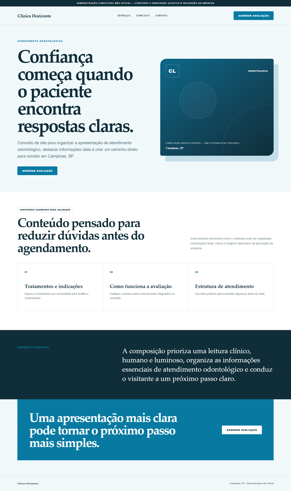
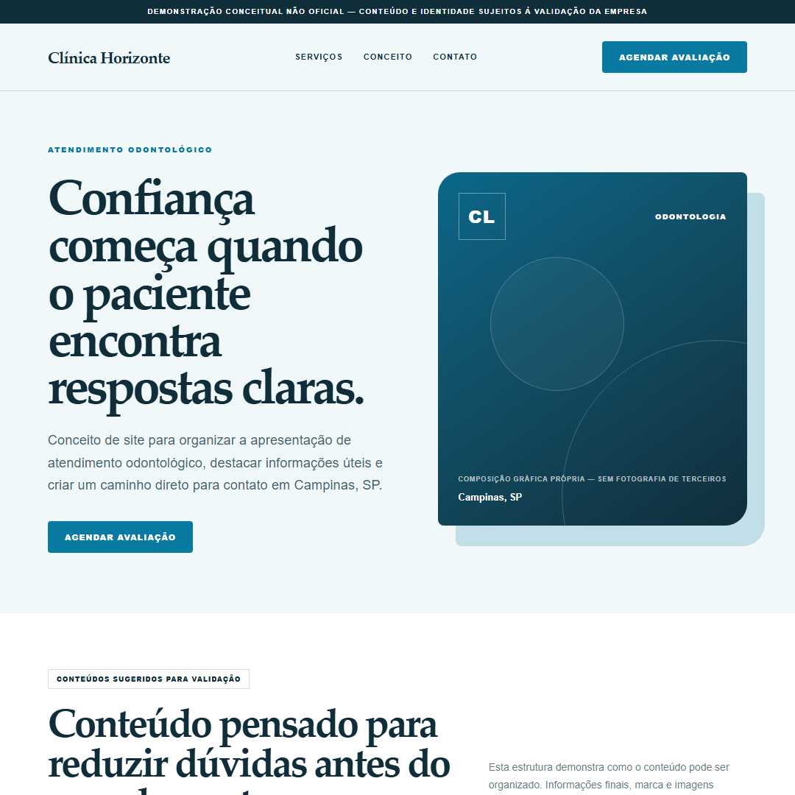
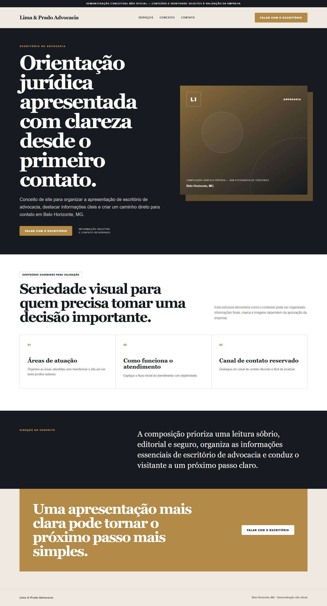
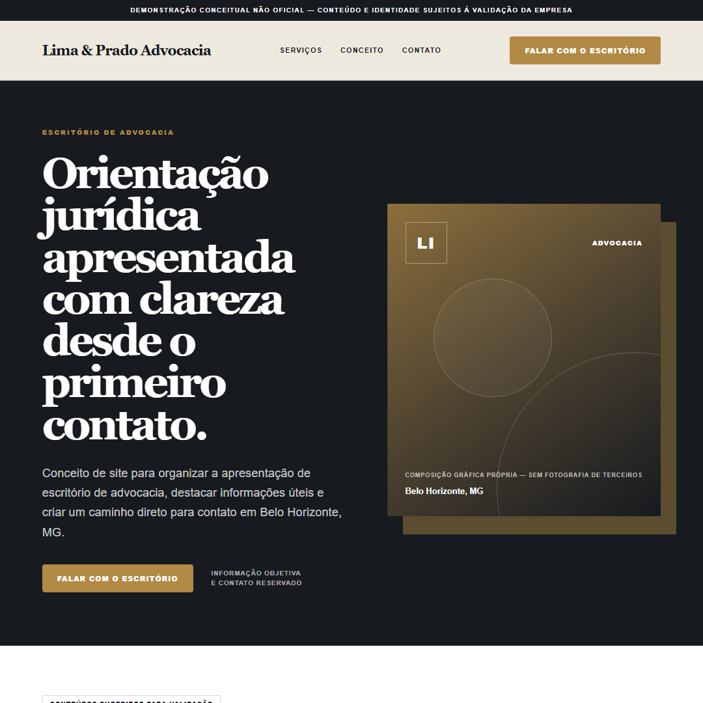
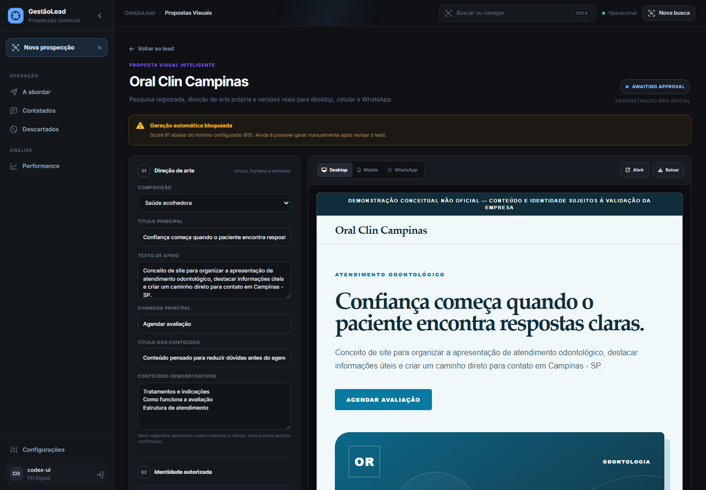
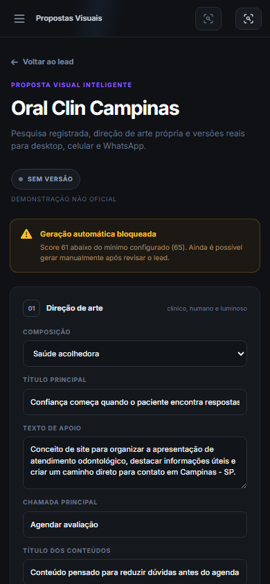
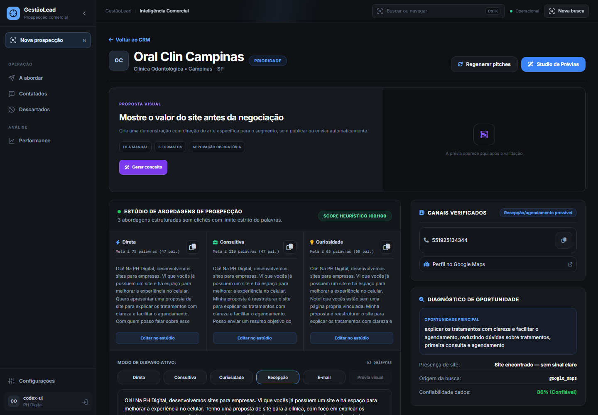
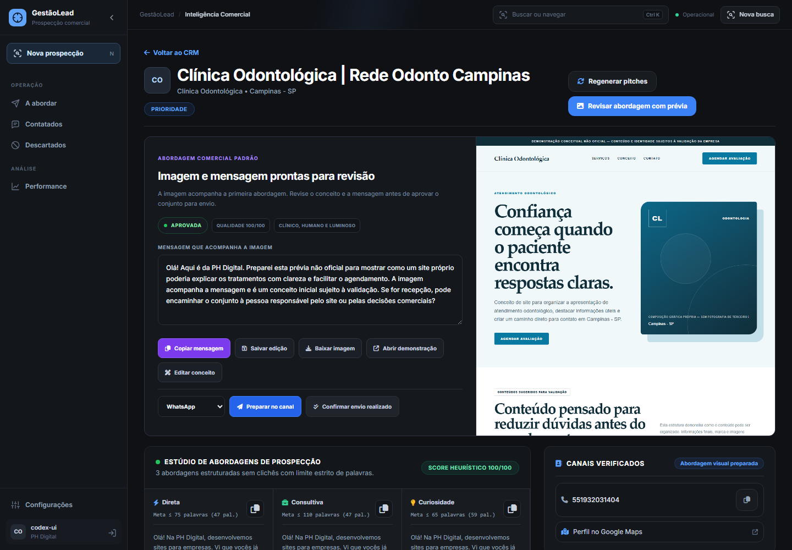

# Propostas Visuais Inteligentes

## Auditoria e causa raiz

O projeto já possuía um estúdio de prévia, porém o fluxo antigo armazenava apenas HTML e gerava um único PNG desktop sob demanda. Não existiam versão mobile, imagem quadrada para WhatsApp, aprovação, publicação controlada, expiração, validação visual, fila persistente ou registro de autorização dos ativos. A rota numérica também era previsível e não separava uma prévia interna de uma demonstração pública.

## Arquitetura implementada

O fluxo atual é:

`lead -> pesquisa normalizada -> direção de arte -> HTML/CSS isolado -> validação estática -> renderização Playwright -> validação em três viewports -> aprovação -> publicação opcional -> registro de envio`

- `preview_studio.py`: normalização, perfis por segmento, direção de arte, HTML responsivo, mensagens, segurança de ativos, renderização e qualidade.
- `app.py`: persistência, limites, fila, retentativas, concorrência, aprovação, publicação com token, expiração, download e registro comercial.
- `templates/studio.html`: edição, upload autorizado, desktop/mobile/WhatsApp, evidências, qualidade, aprovação e envio.
- `templates/lead_detail.html`: resumo da proposta visual dentro do detalhe do lead.
- `templates/configuracoes.html`: limite diário, concorrência, tentativas, expiração e score mínimo.

## Personalização e segurança

- A direção de arte associa categorias equivalentes a perfis próprios, como odontologia, advocacia, arquitetura, estética, engenharia e gastronomia.
- Cada perfil muda composição, cores, tipografia, CTA, serviços sugeridos e hierarquia.
- Serviços não confirmados aparecem como sugestões para validação.
- Fotografias e logotipos somente entram como arquivos locais codificados quando a origem é marcada como própria, autorizada ou licenciada.
- URLs remotas, promessas não comprovadas, Lorem ipsum e ausência do aviso de demonstração reprovam a validação.
- A demonstração pública usa token não previsível, exige aprovação explícita, possui expiração e não é publicada automaticamente.

## Validação automática

O Playwright renderiza:

- desktop em 1440 px;
- mobile em 390 px;
- compartilhamento em 1080 x 1080 px.

O relatório verifica imagens quebradas, overflow horizontal, texto cortado, CTA, console, contraste, recursos remotos e afirmações proibidas. Uma renderização abaixo de 80 pontos ou com erro fica em revisão e não pode ser aprovada.

## Exemplos reais gerados localmente

### Clínica odontológica






### Escritório de advocacia






Os exemplos usam composições gráficas próprias e não incorporam fotografias ou marcas de terceiros.

### Interface administrativa validada







A geração pelo botão do estúdio foi executada em navegador real contra uma cópia do banco. A resposta retornou `200`, validação aprovada com nota `100/100`, iframe carregado, nenhuma exceção JavaScript e nenhum overflow horizontal.

## Abordagem comercial padrão

A estratégia padrão agora é a **Abordagem A**: a primeira mensagem já é preparada junto da imagem demonstrativa. O sistema não pede permissão para mostrar a prévia e não apresenta o conceito como site oficial ou aprovado pela empresa.

O fluxo no CRM é:

`Preparar abordagem com prévia -> gerar e validar -> revisar imagem e mensagem juntas -> editar -> aprovar -> preparar no canal -> confirmar envio realizado`

- A ação `Preparar abordagem com prévia` fica disponível no CRM e no detalhe do lead.
- Depois da geração, a tela apresenta a imagem e a mensagem no mesmo bloco.
- A mensagem menciona que a imagem acompanha o contato e que a proposta é uma demonstração não oficial.
- Aprovar apenas libera a preparação do canal; não altera o lead para enviado.
- Abrir WhatsApp ou e-mail também não registra envio automaticamente.
- O registro comercial só ocorre após a confirmação explícita em `Confirmar envio realizado`.




O fluxo foi validado em navegador real. A geração retornou `200`, a imagem foi renderizada, a mensagem não pediu permissão para envio, a aprovação manteve `sent_at` vazio e nenhuma interação `proposta_visual_enviada` foi criada antes da confirmação final.

## Referências efetivamente analisadas

- Siteinspire: `https://www.siteinspire.com/websites/category/health-and-fitness`
- Siteinspire Decibel Health: `https://www.siteinspire.com/website/11812-decibel-health`
- Siteinspire Minimal: `https://www.siteinspire.com/websites/category/minimal`
- Siteinspire Selected: `https://www.siteinspire.com/websites/selected`
- Lapa Ninja Health & Fitness: `https://www.lapa.ninja/category/health-fitness/`
- Lapa Ninja Vibrant: `https://www.lapa.ninja/post/vibrantpractice/`
- Lapa Ninja Business: `https://www.lapa.ninja/category/business/`
- Awwwards Mobile Excellence: `https://www.awwwards.com/mobile-excellence-guidelines.pdf`
- Awwwards Hot Right Now: `https://assets.awwwards.com/awards/gallery/2023/07/HOT-RIGHT-NOW-BOOK-2023.pdf`

Essas referências orientam composição e acabamento. Nenhum site é copiado integralmente.

## Custos e limites

O motor padrão não chama uma API externa de IA nem um banco de imagens pago. O custo direto por prévia é zero; existem custos indiretos de CPU, memória, armazenamento e tráfego da própria Oracle. Cada proposta produz três PNGs e um HTML. O tamanho final depende do conteúdo enviado.

Os limites são configuráveis. O padrão é 10 propostas por dia, uma renderização simultânea, duas tentativas, expiração em 30 dias e score mínimo 65. O trabalho é persistido em `visual_proposal_jobs`, então falhas e tentativas ficam auditáveis.

## Limitações atuais

- O sistema não baixa automaticamente fotos públicas, pois disponibilidade pública não equivale a licença de reutilização.
- Logotipo e fotos precisam ser fornecidos ou marcados com origem e autorização válidas.
- A fila é persistente, mas a renderização ainda ocorre durante a requisição Flask; não há worker distribuído separado.
- A avaliação visual é verificável por regras de DOM e renderização, não por um modelo multimodal externo.
- Informações com baixa confiança exigem revisão humana antes da aprovação.

## Deploy Oracle

O repositório já possui `.github/workflows/deploy-oracle.yml`. Um push validado para `main` executa, quando os secrets estão configurados:

```bash
cd "${ORACLE_APP_PATH:-/home/ubuntu/gestaoLead}"
git pull --ff-only origin main
python3 -m pip install -r requirements.txt
python3 -m playwright install chromium
sudo systemctl restart "${ORACLE_SERVICE:-gestaolead}"
sudo systemctl is-active --quiet "${ORACLE_SERVICE:-gestaolead}"
```

As colunas e tabelas novas são criadas de forma compatível por `init_db()` na inicialização. O deploy deve preservar `gestao_leads.db`, `.env` e `generated_previews/`.
